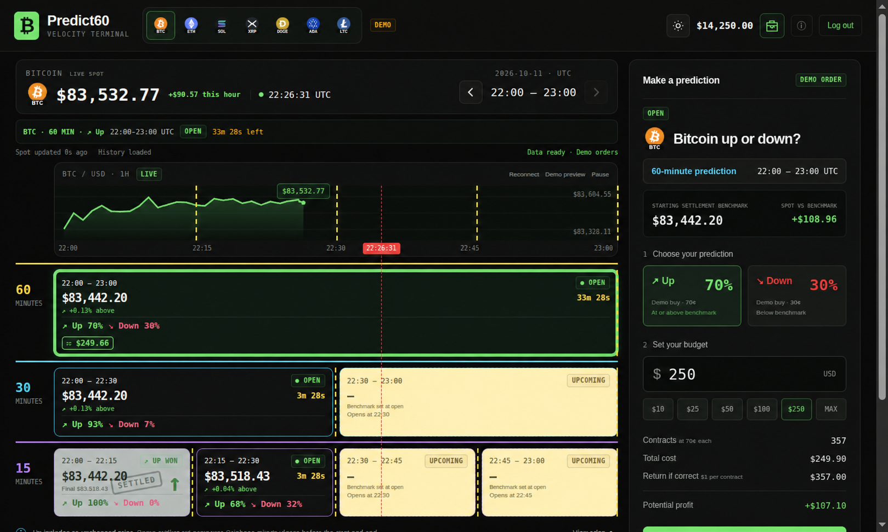
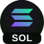

# BTC60 — Crypto prediction terminal

BTC60 is a buildless web app for exploring crypto direction predictions with demo funds. See a complete UTC hour at once: one 60-minute market, two 30-minute markets, and four 15-minute markets, with a live chart and a persistent order ticket.



*Illustrative demo preview. Prices, percentages, and account figures shown are sample values.*

## Overview

- **Complete-hour workspace:** inspect open, upcoming, and completed intervals without hiding duration tiers; navigate previous hours and return to the current hour.
- **Live market context:** Coinbase Exchange ticker updates and minute-candle history, with separate spot freshness, history, and order-readiness indicators.
- **Demo predictions:** choose Up or Down, set a budget, and review whole-contract cost, possible return, and potential profit. Model percentages determine simulated contract prices.
- **Live confirmation:** review follows the market; the server executes at its current model price within your budget. Final quantity and return can differ from review.
- **Persistent accounts:** signup/login, $14,250 starting demo balance, saved predictions, and automatic settlement backed by SQLite.
- **Portfolio tracking:** pending orders, wins, losses, returns, and realized profit/loss, with committed funds shown separately.
- **Display controls:** light/dark themes, responsive layouts, chart pause, reconnect, and an explicit synthetic preview mode.

### Default prediction coins

<p>
  
  
  
  
  
  
  
</p>

BTC · ETH · SOL · XRP · DOGE · ADA · LTC. The database catalog controls availability; all coins share the same account balance.

### Prediction rules

Up wins when the closing benchmark is greater than or equal to the opening benchmark; Down wins when it is lower. Each benchmark uses the minute candle close immediately before its interval boundary. A winning contract returns $1; a losing contract returns $0, with zero demo fees. Missing history leaves orders awaiting settlement for retry.

These are uncalibrated model estimates, simulated prices, and Coinbase minute-close proxy results. BTC60 does not trade real money or claim official Kalshi or CF Benchmarks settlement. Synthetic preview and historical views cannot place orders.

## Run locally

Requires Python 3.10+ on Linux/macOS; no Python packages or frontend build are needed.

```bash
python3 server.py
```

Open http://127.0.0.1:8000 for the welcome page or http://127.0.0.1:8000/index.html for the terminal. Use `--port` to change the port. Internet access is required for live prices, benchmarks, and settlement. The terminal requires `/api/coins`; file previews and static hosting alone cannot initialize a working terminal or provide accounts.

### Automatic crash recovery (Linux)

Start or restart the server with a background watchdog:

```bash
python3 scripts/restart-server.py
# Optional custom port:
python3 scripts/restart-server.py --port 8080
```

The watchdog restarts the server three seconds after it exits. Both processes
inherit your environment (including API keys and `BTC60_DB`), and append output to
`/tmp/btc60/server.log`. Only one watchdog can run for this checkout.

To stop intentionally:

```bash
python3 scripts/stop-server.py
```

This stops the watchdog and server and writes `data/server.stopped`, preventing
automatic restarts. Run `restart-server.py` again to clear the marker and resume.
These scripts manage this checkout's processes; they do not install boot-time
startup or monitor HTTP health. Running `python3 server.py` directly bypasses the
watchdog.

### Logging and rotation

`restart-server.py` initially defaults to `normal` and reuses the log level from
the last successful start when `--log-level` is omitted. Normal logs record user
POST actions, successful authentication and predictions, completed settlements,
server/watchdog lifecycle events, and important failures. Routine GET requests
and polling are omitted. Debug preserves HTTP request logging and adds diagnostic
tracebacks; request bodies, passwords, and session cookies are not logged.

```bash
python3 scripts/restart-server.py --log-level debug
python3 scripts/restart-server.py --log-level normal
```

`warning` and `error` levels are also available. The selected level survives
watchdog restarts. Logs go to `/tmp/btc60/server.log`, with automatic rotation at
10 MiB and five numbered backups (`server.log.1` is newest). The watchdog captures
server stdout/stderr, so unexpected crashes are retained. Each write opens the
current log under a shared lock, allowing safe rotation while the server runs.

Apply the same policy manually, or force an immediate rotation:

```bash
python3 scripts/rotate-logs.py
python3 scripts/rotate-logs.py --force
```

No scheduled job is needed: rotation runs as logs are written. On the next
restart, the old `data/server.log` is imported under the same retention policy
and removed. `/tmp` logs may be cleared on reboot; `BTC60_LOG_DIR` can override
the directory when persistent storage is desired. Direct `server.py` runs log to
the console and support the same `--log-level` option.

## Documentation

- [Admin guide](doc/ADMIN_GUIDE.md): server scripts, log levels, rotation, maintenance, and troubleshooting.
- [User guide](doc/USER_GUIDE.md): accounts, predictions, history, portfolio, and troubleshooting.
- [Design](doc/DESIGN.md): interaction, pricing, settlement, architecture, and persistence.
- [Database maintenance](doc/DATABASE_MAINTENANCE.md): initialization, inspection, backups, and explicit reset.

## Code documentation (Sphinx)

Python modules and procedures have docstrings; named browser procedures have JSDoc.
The Sphinx reference includes source listings, signatures, and branch/iteration
inventories, plus an architecture guide. Build it without executing app modules:

```bash
python3 -m pip install -r docs/requirements.txt
npm install --prefix docs
python3 -m sphinx -W --keep-going -b html docs docs/_build/html
```

Open `docs/_build/html/index.html`. See [documentation maintenance](docs/contributing.rst).
Sphinx requires Python 3.11+; runtime requirements for the app are unchanged.
Node.js and the docs-only Acorn dependency parse browser source. Generated pages
and rendered docs are ignored by Git and excluded from the static app build.

## Development and validation

The root files are the application source. `bootstrap.js` loads the database coin catalog before loading the model, trading controller, and chart. `server.py` serves the interface and account API with SQLite persistence. Keep development on the `Phase1` branch.

```bash
node --test *.test.js
python3 -m unittest discover -p '*_test.py'
python3 -m unittest discover -s scripts -p '*_test.py'
node --check app.js
node --check btc-chart.js
```

Tests cover market calculations, catalog/bootstrap behavior, portfolio summaries, restored and expired sessions, login/signup errors, logout and settlement retries, community polling, weather benchmark boundaries, static build isolation, account/order/settlement handling, and database maintenance. They do not establish live Coinbase availability.

## Data and catalog

The default database is `data/btc60.sqlite3`; `BTC60_DB` selects another path. Startup creates missing tables and applies catalog migrations. Accounts start with $14,250 in demo funds. Browser-only positions are not imported. Database files and backups are excluded from Git.

The database `coins` table is authoritative. The crypto seed has ten records: BTC, ETH, SOL, XRP, DOGE, ADA, and LTC enabled; LINK, TRUMP, and AVAX disabled. Existing databases can have administrator edits. Triggers allow at most eight enabled instruments per category. Disabling a coin blocks new orders while preserving history and settlement. Keep referenced symbols and product mappings stable.

`coins.seed.json` seeds new databases; editing it does not overwrite existing catalog rows. One-time migrations add catalog entries and replace LINK selection with LTC while retaining LINK history. Refresh the terminal after database catalog edits.

```sql
BEGIN;
UPDATE coins SET enabled=0 WHERE symbol='DOGE';
UPDATE coins SET enabled=1 WHERE symbol='AVAX';
COMMIT;
```

Custom coins need a supported Coinbase USD product, display precision, positive demo base, and sort order. Optional local SVG icons belong under `assets/coins/`; a blank icon uses a text button. See the maintenance guide before changing or resetting a database.

## Static distribution and hosting

`dist/` contains static copies, not a standalone account backend. After frontend changes, run `python3 scripts/build-static.py` to refresh the public HTML, CSS, browser JavaScript, and artwork in `dist/`. The build uses the server’s public file list and excludes backend scripts, tests, credentials, and account data. The welcome preview is `assets/previews/prediction-playfield.png`. `.openai/hosting.json` identifies the existing private Site.

The Python server binds to loopback for local development. Public account hosting requires a production server, HTTPS, Secure session cookies, and account recovery/email verification. Static hosting cannot replace the Python/SQLite API.

Odds use adaptive trailing 24-hour volatility and a normal-CDF probability model. To fit and validate historical calibration, run `python3 scripts/calibrate-odds.py BTC candles.json`; see [model details](doc/DESIGN.md#estimates-and-demo-pricing). Without a validated artifact, probabilities are labeled uncalibrated.

Historical calibration can be prepared with resumable downloads:

```bash
python3 scripts/download-odds-history.py BTC-USD data/btc-candles.json --days 30
python3 scripts/calibrate-odds.py BTC data/btc-candles.json
```

Both commands report progress. Rerun the download command after interruption to resume saved batches. Coinbase must be reachable from the machine running it. Calibration activates only if held-out Brier score and log loss both improve; otherwise the existing model is preserved. Repeat using each coin's product and symbol. Reload the terminal after a successful calibration export.

## Market categories: Oil and Crypto

The entry screen at `/` (or `welcome.html`) offers login and signup. Signed-in visitors go directly to `categories.html`, which loads category buttons from `/api/categories`. Weather is visible as Coming soon with disabled instruments; see [weather preparation](doc/WEATHER.md).
Choose **Oil** or **Crypto** to open the same one-hour playfield at
`index.html?category=oil` or `index.html?category=crypto`. The existing 15-, 30-,
and 60-minute intervals remain aligned inside that hour. Each category has its own
background, accent, instrument selection, and remembered instrument. The portfolio
shows both categories and can filter history and statistics by category; the demo
balance is shared.

Crypto retains Coinbase USD prices and minute-close proxy settlement. Oil now uses
**Twelve Data live spot quotes** and exact one-minute history for new predictions.
The public provider catalogue verifies WTI (`WTI/USD`) and Brent (`XBR/USD`).
Dubai, Oman, and Bonny Light remain visible but have no verified provider mapping;
they show an unavailable feed instead of synthetic values. Urals is available from
the provider but has not replaced any requested crude grade.

Configure `TWELVE_DATA_API_KEY` (or `TWELVEDATA_API_KEY`) in the server process and
restart it. For an interactive local session, read the key without placing it in
shell history:

```bash
read -r -s -p "Twelve Data API key: " TWELVE_DATA_API_KEY
export TWELVE_DATA_API_KEY
python3 server.py
```

The key stays server-side and is sent in an Authorization header. The provider
subscription must include commodities. This adapter uses minute-updated REST spot
quotes, not WebSocket streaming. Quotes are cached for 20 seconds across clients,
and the original provider quote timestamp is preserved. Oil prices older than
90 seconds, closed sessions, missing keys, unsupported grades, and missing exact
benchmark minutes block new orders. Crypto retains its 15-second freshness limit.
Category cards show source readiness and real oil quotes when available.

`live_oil.py` supplies quotes and minute history. No live request falls back to
simulation. Old oil predictions keep their original deterministic simulated source
from `simulated_prices.py`, so their settlement does not change after upgrading.
The separate synthetic-preview mode remains available and cannot place orders.

Startup migrates the database in place: `categories` stores category presentation,
and the existing `coins` instrument table gains `category`, `feed`, and `unit`.
Legacy symbols default to Crypto/Coinbase/USD. Version 3 adds five oil records from
`oil.seed.json`, preserving existing users, sessions, predictions, balances, and
administrator edits on subsequent restarts. Enabled-instrument limits are eight
**per category**. Instruments with saved predictions cannot change category or price
source, including a simulated base price, because that would change their settlement.
`categories.seed.json` seeds missing categories without overwriting existing metadata.

To add a future category, add its metadata to `categories` and its instruments to
`coins` with the appropriate category ID, supported feed, unit, precision, and sort
order. The entry screen and portfolio discover categories from the database. A new
feed type requires an explicit backend adapter and frontend transport; unsupported
feeds must not masquerade as live prices. `coins` and `/api/coins` keep their legacy
names for compatibility, but now contain all instrument types.

After pulling this change, restart `python3 server.py` to apply migrations and open
`http://127.0.0.1:8000/`. To migrate explicitly while the server is stopped, use
`python3 scripts/database.py init`. Back up first with
`python3 scripts/database.py backup`.

### Live feed migration

Version 4 adds `instrument_sources` for authoritative feed overrides and
`prediction_sources` to freeze the provider/product used by each new prediction.
The legacy `coins.feed` field is retained so pre-upgrade orders settle with their
original source. The browser catalog merges the override and exposes `twelvedata`
for new oil prices. All five requested crude grades remain in the catalog; unmapped
products return an explicit unavailable response. Adding a mapping requires
verifying that the provider symbol represents the same crude, currency, and unit.

Validation includes `python3 -m unittest live_oil_test.py categories_test.py` for
provider parsing, credentials, cache behavior, quote freshness, migration, and
legacy-source preservation. Provider network calls are mocked in automated tests;
a successful live quote with the user's subscription is still required before
claiming live activation.

### OilPriceAPI trial connection

The local server also supports `OILPRICE_API_KEY`, or a server-only key file at
`data/oilpriceapi.key` with mode 0600. The data directory is ignored by Git and
blocked by the server's public asset allowlist. Never put credentials in browser
code. Restart the server after configuring the key.

With OilPriceAPI configured, all five oil instruments use verified physical spot
assessment codes: WTI_SPOT_USD, BRENT_SPOT_USD, DUBAI_CRUDE_USD, OMAN_CRUDE_USD,
and BONNY_LIGHT_USD. Quotes are cached for five
seconds per grade. Oil prices and the observation graph refresh every five seconds.
Graph points record when an assessment was checked; its original source date is
shown separately. Repeated values do not imply new market trades. The selector and banner show the
latest assessment with its original observation date, including delayed values.
No carried-forward synthetic value or futures contract is substituted.

These physical spot series do not supply exact minute candles. Oil orders remain
blocked under the existing hourly settlement rules; Crypto continues normally.
The faster WTI_USD and BRENT_CRUDE_USD series are front-month futures and are not
mapped as spot. Migration 5 expands instrument source providers while retaining
existing prediction source snapshots and account data.
